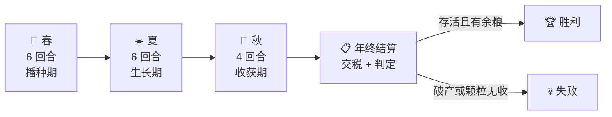
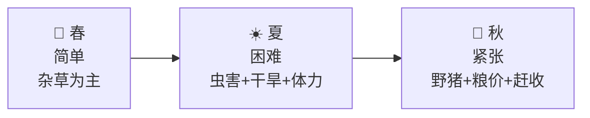

# 🌾 《田间风云》— 卡牌种田小游戏 设计文档

> **Game Design Document v2.2**
> 类型：卡牌构筑 × 种田经营（轻量 Roguelike）
> 参考：[Cardwork Cycle](https://honey-pony.itch.io/cardwork-cycle) by HoneyPony
> 平台：浏览器 HTML5 / PC 桌面端
> 单局时长：15–30 分钟
> 引擎：Godot 3.5.3

> [!WARNING]
> **本文档为历史设计稿（v2.2），数值与结构已被工程迭代覆盖。**
> 当前实际规则：**24 候（四季各 6）**、五档官品（岁赋 18/24/24/24/32）、每候体力 3、抽 5 张、初始 5 块耕地；虫潮按品级 3–4 候一波，三品/一品有固定虫王与旱期（三品 10–12 候、一品 10–14 候双倍耗水）。
> 以 `GameIame/` 代码与 [docs/关卡数值平衡调研报告.md](docs/关卡数值平衡调研报告.md) 为准；本文中的 16 回合、三档难度、天气牌堆、12 张起始牌组等内容仅作早期设计参考。

---

## 一、一句话定义

> **用一副牌种一年地，扛过天灾虫害和粮价暴跌，活到秋收。**

Cardwork Cycle 证明了"卡牌驱动种田"这个公式能跑通。我们在同等体量下，把重心从"塔防害虫 + 种出传说植物"**转向"体验真实种地的艰辛"**：天灾、虫害、体力极限、市场波动——让年轻玩家在 20 分钟内感受到"粒粒皆辛苦"。

---

## 二、从 Cardwork Cycle 借鉴什么、改变什么

| 借鉴 ✅ | 改变 🔄 |
|---------|---------|
| 卡牌驱动一切农事操作 | 增加**天气牌堆**（不可控自然因素） |
| 能量/体力限制每回合行动 | 体力 = "人一天能干的活有限" |
| 作物成熟 → 奖励新卡牌 | 作物成熟 → 奖励新卡 **或 卖钱交税** |
| 简洁 2D 矢量美术风格 | 保持同风格，加入中国田园配色 |
| 害虫从外部入侵（塔防） | 障碍多样化：**天灾 + 虫害 + 经济压力** |
| 无剧情叙事 | 加入**旁白文字**串联体验，无 NPC 实体 |
| 单一终极目标（世纪之花） | 目标 = **活过四季，秋收后不破产** |

---

## 三、游戏结构

### 3.1 整体流程



> [!IMPORTANT]
> 一局 = **一年（春→夏→秋）= 16 回合**。没有冬季——秋收后直接结算，干净利落。

### 3.2 单回合结构（4 阶段）

| 阶段 | 名称 | 内容 |
|------|------|------|
| ① | **抽牌** | 从牌组抽 5 张手牌 |
| ② | **行动** | 消耗体力打出手牌（种/浇/肥/除虫/收） |
| ③ | **天气翻牌** | 从天气牌堆翻 1 张，立即生效（可能是好事也可能是灾） |
| ④ | **生长结算** | 有水的作物 +1 生长；缺水的作物受损；成熟作物可收获 |

---

## 四、资源系统（只有 3 种，极简）

| 资源 | 符号 | 说明 |
|------|------|------|
| **体力** | 💪 | 每回合 3 点。打牌消耗 1-2 点。用完就只能看着。**这就是"人力有限"** |
| **金币** | 🪙 | 卖收获物获得。用于交税、买新卡、修工具。**经济命脉** |
| **水位** | 💧 | 田地共享水池。浇水卡/雨天增加，干旱消耗。**靠天吃饭** |

> 没有单独的种子/肥料资源——全靠手牌中有没有对应的卡牌。**抽不到就是没有，这就是无奈。**

---

## 五、卡牌系统

### 5.1 起始牌组（12 张）

| 卡牌 | 数量 | 体力 | 效果 |
|------|------|------|------|
| 🌱 播种 | ×3 | 1 | 在空田地种下基础作物 |
| 💧 浇水 | ×5 | 1 | 目标田地 +2 水位 |
| 🧪 施肥 | ×2 | 1 | 目标作物品质 +1（影响卖价） |
| 🪓 除草 | ×2 | 1 | 清除目标田地的杂草状态 |

### 5.2 四类卡牌总表

#### 🟢 农事卡（玩家打出）

| 卡牌 | 体力 | 效果 | 获取方式 |
|------|------|------|---------|
| 播种 | 1 | 种下 1 棵基础作物 | 起始 / 商店 |
| 良种播种 | 1 | 种下 1 棵优质作物（生长快、卖价高） | 收获奖励 |
| 浇水 | 1 | 目标田 +2 水位 | 起始 / 商店 |
| 灌溉 | 2 | 所有田地 +1 水位 | 收获奖励 |
| 施肥 | 1 | 品质 +1 | 起始 / 商店 |
| 除草 | 1 | 清除杂草 | 起始 |
| 除虫 | 1 | 清除轻度虫害 | 商店 |
| 农药 | 2 | 清除重度虫害，但土壤品质 -1 | 商店 |
| 收获 | 1 | 收割 1 棵成熟作物，获卡牌奖励或金币 | 起始加入 / 商店 |

#### 🔵 工具卡（持续增益）

| 卡牌 | 体力 | 效果 | 获取方式 |
|------|------|------|---------|
| 稻草人 | 0 | 本季免疫鸟害 | 商店 |
| 水车 | 0 | 每回合自动给 1 块田 +1 水位 | 商店（贵） |
| 地膜覆盖 | 1 | 目标田免疫寒潮 3 回合 | 商店 |
| 锄头 | 0 | 本回合除草不消耗体力 | 收获奖励 |

#### 🟡 天气卡（系统翻出，不可控）

> [!WARNING]
> 天气卡不在玩家牌组中，而是单独的**天气牌堆**，每回合自动翻 1 张。玩家无法控制，只能应对。这是"靠天吃饭"的核心体现。

| 卡牌 | 效果 | 在牌堆中数量 |
|------|------|------------|
| ☀️ 晴天 | 所有作物 +1 生长 | ×6 |
| 🌤️ 多云 | 无特殊效果 | ×3 |
| 🌧️ 小雨 | 全体水位 +1 | ×3 |
| ⛈️ 暴雨 | 全体水位 +3，但 1 块田有概率涝灾 | ×2 |
| 🌪️ 大风 | 随机 1 棵作物受损（-1 生命） | ×1 |
| ☀️ 干旱 | 全体水位 -2，持续到下次下雨 | ×1（夏季加入） |

**天气牌堆按季节组成：**
- 🌸 春：晴×3 + 多云×2 + 小雨×2 + 大风×1 = 8 张
- ☀️ 夏：晴×3 + 暴雨×1 + 干旱×1 + 多云×1 = 6 张（风险更高）
- 🍂 秋：晴×2 + 小雨×1 + 大风×1 = 4 张

#### 🔴 障碍卡（混入天气牌堆或事件触发）

| 卡牌 | 效果 | 触发方式 | 教育意义 |
|------|------|---------|---------|
| 🐛 蚜虫 | 目标田进入虫害，不清除则每回合 -1 生长 | 夏季天气牌堆混入 | 病虫害防治 |
| 🌿 杂草疯长 | 2 块田长出杂草，停止生长 | 春/夏随机 | 杂草争养分 |
| 🐗 野猪来了 | 随机 1 棵成熟作物被毁 | 秋季天气牌堆混入 | 野生动物侵害 |
| 📉 粮价暴跌 | 本季所有收获物卖价减半 | 秋季结算时 50% 概率 | 谷贱伤农 |
| 💪 腰酸背痛 | 下回合体力 -1 | 连续 3 回合打满体力 | 劳累伤身 |
| 🦗 蝗灾 | 所有田地进入虫害 | 极低概率 | 天灾无情 |

---

## 六、作物系统

### 6.1 生长流程（3 阶段，简洁）


### 6.2 作物表

| 作物 | 成熟回合 | 基础卖价 | 特性 | 解锁 |
|------|---------|---------|------|------|
| 🥬 白菜 | 2 回合 | 3 🪙 | 新手之友，生长快，抗灾能力强 | 起始 |
| 🌾 水稻 | 3 回合 | 5 🪙 | 主粮，需水量较多（每次需要2点水） | 起始 |
| 🌽 玉米 | 3 回合 | 6 🪙 | 抗风抗旱，不易受灾 | 起始 |
| 🍅 番茄 | 4 回合 | 9 🪙 | 易招虫害，但市场卖价较高 | 收获解锁 |
| 🍇 葡萄 | 5 回合 | 15 🪙 | 高价值经济作物，需持续细心看护 | 收获解锁 |
| 🌹 金稻 | 6 回合 | 25 🪙 | 传说作物，种出并收割直接触发特殊成就 | 稀有获得 |

### 6.3 关键收获机制：留种 vs 变现

> [!IMPORTANT]
> 作物成熟收割时，弹出二选一窗口（模拟真实农业中的自留种）：
> - **💰 运往市集（变现）**：直接获得对应金币，用于缴纳税金和购买工具。
> - **🌾 选优留种（补牌）**：不换取金币，而是将 1 张对应的**高阶良种卡**加入抽牌堆（生长更快、品质+1）。
> 
> *这个机制赋予玩家极大的战术自由度：春夏季多留种滚雪球，夏秋季全力变现冲税金！*

---

## 七、障碍体验设计（教育核心）

> [!NOTE]
> 这些不是"惩罚玩家"，而是让玩家**亲身经历**农民面对的困境。每次遭遇障碍时，屏幕底部弹出一行旁白，把教育融入体验。

### 旁白示例

| 触发场景 | 旁白文字 |
|---------|---------|
| 体力用完 | *"太阳还没下山，但你的腰已经直不起来了。"* |
| 干旱发生 | *"井里的水越来越少。你望着开裂的田地，无能为力。"* |
| 虫害蔓延 | *"昨天还只有一小片，今天已经半块田都是虫了。"* |
| 粮价暴跌 | *"辛苦一整季，卖的钱还不够买下季的种子。"* |
| 收获成功 | *"沉甸甸的，这就是你用汗水换来的。"* |
| 野猪毁田 | *"一夜之间，快要成熟的庄稼被糟蹋得不成样子。"* |
| 交不起税 | *"催款单又来了。你翻遍了口袋，凑不出这个数。"* |
| 腰酸背痛 | *"身体是自己的。可地里的活，不等人。"* |
| 成功过冬 | *"你活下来了。明年，你会更有经验。"* |
| 种出金稻 | *"村里人都说不可能，但你做到了。"* |

### 障碍出现节奏



- **春季**：教学期，障碍温和（只有杂草），让玩家熟悉流程
- **夏季**：压力期，虫害、干旱、体力透支同时袭来
- **秋季**：收获期，时间紧迫 + 经济压力（粮价波动 + 交税）

---

## 八、商店系统

每个季节切换时打开商店，可以：

| 操作 | 效果 | 价格 |
|------|------|------|
| 🃏 买新卡 | 从 3 张随机卡中选购 | 3-8 🪙 |
| 🗑️ 移除卡 | 从牌组删掉 1 张弱卡（精简牌组） | 2 🪙 |
| 💪 补充体力 | 下季体力上限 +1 | 5 🪙 |
| 💧 修水渠 | 每回合基础水位 +1 | 6 🪙 |

---

## 九、难度模式（经实测再平衡）

### 三档难度对比

| 参数 | 🌿 悠闲模式 | ⚖️ 普通模式 | 🔥 困难模式 |
|------|-----------|-----------|-----------|
| **每回合体力** | 4 | 3 | 2 |
| **起始金币** | 8 🪙 | 4 🪙 | 0 🪙 |
| **田地格数** | 8 格 | 6 格 | 4 格 |
| **手牌上限** | 6 张 | 5 张 | 4 张 |
| **秋收税金** | **8 🪙** | **12 🪙** | **16 🪙** |
| **天气牌堆·灾害比例** | 几乎无灾 | 标准（小雨/晴天/暴雨偶现） | 密集（大风/暴雨/干旱连番轰炸） |
| **障碍卡混入数量** | 1 张 | 3 张 | 6 张 |
| **虫害蔓延速度** | 3 回合后蔓延 | 2 回合后蔓延 | 1 回合后蔓延 |
| **粮价暴跌概率** | 10% | 35% | 60% |
| **腐烂宽限期** | 3 回合 | 2 回合 | 1 回合 |
| **实测通关率** | **~97%** | **~57%** | **~20%** |

---

## 十、年度结算与死因诊断系统

> [!IMPORTANT]
> 游戏采取 **16 回合单局短平快制**（约 15 分钟），秋末交一次税。
> 无论成功与失败，结算界面简洁明了，随时可一键重新开局。

### 10.1 通关评价

* 🏆 **传说通关（收获金稻）**：
  > *“村里老把式都说金稻已百年未见，但你做到了。沉甸甸的金色稻穗在秋风中摇曳，你不仅还清了所有税金，更成为了十里八乡的传奇。”*
* ⭐ **富裕通关（金币 ≥ 税金 × 1.5）**：
  > *“不仅缴清了整年的税金，地窖里还堆满了来年的良种。你是全村后生里最懂天时与节气的庄稼人！”*
* ✅ **基础通关（金币 ≥ 税金）**：
  > *“你擦了擦额头的汗，勉强凑齐了税钱。虽然粮仓没剩下几粒米，但你守住了这片田。这一年，你真正体会到了什么是‘面朝黄土背朝天’。”*

### 10.2 失败死因诊断报告（输在哪里一目了然）

当秋末结算金币不足税金，或地里作物全灭时，系统会**根据当局行为日志精准诊断主要败因**：

| 诊断类型 | 典型场景 | 诊断报告与教育警示 |
| :--- | :--- | :--- |
| 🛑 **【败因：大旱绝收】** | 因缺水/干旱枯死 2 棵以上作物 | *“夏季连续干旱，井底见石。你手头缺少储水与灌溉手段，只能眼看着作物龟裂枯萎。天灾无情，靠天吃饭的脆弱莫过于此。”* |
| 🛑 **【败因：虫害失控】** | 虫害持续未清理导致蔓延 | *“初见蚜虫时你未予重视，忙于抢种。最终病虫害肆虐整片田野，颗粒无收。防微杜渐，在田间从来不是一句空话。”* |
| 🛑 **【败因：谷贱伤农】** | 总产出足够，但被粮价下跌扣减 | *“庄稼长势喜人，怎奈丰产不丰收。秋市粮价暴跌，中间商趁机压价。辛苦一整年，利润全被市场行情吞噬。”* |
| 🛑 **【败因：力不从心】** | 体力耗尽，作物熟透烂在地里 | *“你盲目扩大种植，却高估了人的体力极限。地里瓜果累累，却根本来不及收割而尽数腐烂。农活，从来是一铲一镐干出来的。”* |
| 🛑 **【败因：牌组臃肿】** | 抽不到关键牌，大量空过回合 | *“牌组里堆积了太多低效农事，整个夏秋你都在盲目抽牌，错失了翻土与播种的最佳农时。”* |

---

## 十一、UI 布局

```
┌──────────────────────────────────────────────┐
│  ☀️ 夏·第3回合    💪 2/3    🪙 12    💧 4     │
├──────────────────────────────────────────────┤
│                                              │
│    ┌───┐ ┌───┐ ┌───┐ ┌───┐ ┌───┐ ┌───┐    │
│    │🌱 │ │🌿 │ │🌾 │ │   │ │🌿 │ │🌱 │    │
│    │💧2│ │💧1│ │收! │ │空地│ │🐛 │ │💧3│    │
│    └───┘ └───┘ └───┘ └───┘ └───┘ └───┘    │
│                                              │
├──────────────────────────────────────────────┤
│  ┌────────────────────────────────────────┐  │
│  │ 💬 "太阳毒得很，地里的水蒸发得越来越快。" │  │
│  └────────────────────────────────────────┘  │
├──────────────────────────────────────────────┤
│                                              │
│    ┌────┐ ┌────┐ ┌────┐ ┌────┐ ┌────┐     │
│    │💧  │ │🌱  │ │🧪  │ │🪓  │ │🫳  │     │
│    │浇水│ │播种│ │施肥│ │除草│ │收获│       │
│    │ ❶ │ │ ❶ │ │ ❶ │ │ ❶ │ │ ❶ │       │
│    └────┘ └────┘ └────┘ └────┘ └────┘     │
│                                              │
│  [结束回合]              牌组:9  弃牌:6      │
└──────────────────────────────────────────────┘
```

**关键 UI 要素：**
- 顶部：季节/回合 + 三大资源状态栏
- 中部：田地网格（6 格，可通过商店扩展到 8 格）
- 旁白栏：事件/教育文字浮现区域（替代 NPC）
- 底部：弧形手牌 + 结束回合按钮
- 拖拽打牌：将手牌拖到目标田地上释放

---

## 十二、美术风格

参照 Cardwork Cycle 的**简洁 2D 矢量风格**：

| 要素 | 描述 |
|------|------|
| 整体 | 干净矢量图形，暖色调，非像素风 |
| 田地 | 柔和棕绿色土地格子，作物用简洁图标 |
| 卡牌 | 明亮主色调：蓝=水，绿=种植，橙=工具，红=障碍 |
| 状态 | 作物上方浮动小图标：💧水位 / ❤️生命 / 🐛虫害 |
| 季节变化 | 背景色调随季节渐变：嫩绿→金黄→橙棕 |
| 天气表现 | 天气卡翻出时全屏轻微滤镜（雨天暗蓝、干旱发黄） |
| 旁白 | 底部半透明文字框，手写体字体缓缓浮现 |

---

## 十三、音频

| 场景 | 音效 |
|------|------|
| 打出卡牌 | 轻柔的"嗒"声 |
| 浇水 | 水流声 |
| 收获 | 清脆的割麦声 + 金币叮当 |
| 天气翻牌 | 翻牌声 + 对应天气环境音（雨声/风声/蝉鸣） |
| 障碍触发 | 低沉警示音 |
| 旁白出现 | 轻微纸张声 |
| BGM | 一首循环的田园吉他/笛子轻音乐，季节切换时变调 |

---

## 十四、技术方案

| 项目 | 方案 |
|------|------|
| 引擎 | Godot 3.5.3 |
| 语言 | GDScript |
| 导出 | HTML5（浏览器） + Windows 桌面 |
| 数据 | 卡牌/作物/天气数据用 JSON 配置 |
| 存档 | 无需存档（单局 15-30 分钟） |
| 目标大小 | < 50MB |

### 项目结构

```
田间风云/
├── scenes/
│   ├── main_menu.tscn       # 主菜单
│   ├── game_board.tscn       # 游戏主界面
│   └── shop.tscn             # 季节间商店
├── scripts/
│   ├── game_manager.gd       # 回合/季节流程控制
│   ├── card_system.gd        # 手牌管理 + 打牌逻辑
│   ├── field.gd              # 田地格子 + 作物状态
│   ├── weather_deck.gd       # 天气牌堆
│   ├── narrator.gd           # 旁白系统
│   └── shop.gd               # 商店逻辑
├── data/
│   ├── cards.json            # 卡牌数据
│   ├── crops.json            # 作物数据
│   ├── weather.json          # 天气牌数据
│   ├── narration.json        # 旁白文本
│   └── difficulty.json       # 难度参数配置
├── assets/
│   ├── art/                  # 矢量图形资产
│   ├── audio/                # 音效 + BGM
│   └── fonts/                # 字体
└── project.godot
```

---

## 十五、开发计划（4 周）

| 周 | 目标 | 交付 |
|----|------|------|
| **Week 1** | 核心循环 | 回合流程 + 抽牌打牌 + 田地格子 + 作物生长 |
| **Week 2** | 天气 + 障碍 | 天气牌堆 + 障碍事件 + 商店 + 收获奖励选择 |
| **Week 3** | 叙事 + 美术 | 旁白系统 + 矢量美术资产 + 音效 + 季节视觉变化 |
| **Week 4** | 打磨 + 发布 | 数值平衡 + 胜负结算 + 导出 HTML5 + 上线 itch.io |

---

## 十六、一局体验速览

> **春·第 1 回合**
> 抽到：播种 × 2、浇水 × 2、除草 × 1
> → 播种白菜（-1💪），播种水稻（-1💪），浇水白菜（-1💪）
> → 天气翻牌：☀️ 晴天 → 所有作物 +1 生长
> → 旁白：*"第一天，一切看起来都很简单。"*

> **夏·第 2 回合**
> 抽到：浇水 × 1、施肥 × 1、收获 × 1、除草 × 1、播种 × 1
> → 浇水番茄（-1💪），施肥葡萄（-1💪），除草稻田（-1💪）
> → 天气翻牌：**☀️ 干旱** → 全体水位 -2！
> → 旁白：*"三天没下雨了。井水也快见底了。"*
> → 💪 体力用完，眼看着另外两块田没水浇……
> → 旁白：*"你想多干一点，但身体不答应。"*

> **秋·第 3 回合**
> 番茄成熟！收获 → 选择拿 8🪙（需要攒钱交税）
> → 天气翻牌：**🐗 野猪来了** → 葡萄被毁！
> → 旁白：*"快要熟的葡萄，一夜之间没了。五个回合的心血。"*

> **结算**
> 金币：14🪙 / 税金：15🪙 → **差 1 块钱，破产。**
> → 旁白：*"就差这么一点。这就是种地。"*

---

> *v2.2 | 2026-11-19*
> *参考：[Cardwork Cycle](https://honey-pony.itch.io/cardwork-cycle) by HoneyPony*
